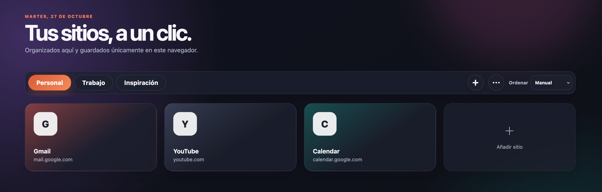

# Ginger Dial

Extensión Chrome Manifest V3 que sustituye la nueva pestaña por una cuadrícula visual y personalizable de accesos rápidos.

## Vista previa



## Funciones

- Organiza accesos rápidos por grupos.
- Busca, reordena, crea, edita y elimina accesos.
- Consulta los marcadores de Chrome desde el panel lateral.
- Elige tema claro, oscuro o del sistema, además de fondos incluidos o propios.
- Importa y exporta grupos, accesos y preferencias mediante un JSON local.

## Privacidad

- Los grupos, accesos y preferencias se guardan exclusivamente en `chrome.storage.local`.
- Los fondos personalizados se optimizan a WebP y se guardan en el mismo almacenamiento local.
- No hay cuenta, telemetría, sincronización ni API remota.
- La exportación e importación se hace mediante un archivo JSON local iniciado por el usuario.

La extensión solicita `storage` para persistir sus datos, `bookmarks` para mostrar el árbol de marcadores, `favicon` para mostrar iconos de sitios y acceso de host para cargar favicons e iconos personalizados elegidos por el usuario.

## Fondos y temas

La pantalla de personalización incluye seis fondos predefinidos originales, tema claro/oscuro/sistema, intensidad regulable y carga de imágenes PNG, JPEG o WebP desde el ordenador. Las imágenes se limitan a 25 MB de entrada y se reducen a un máximo de 2560×1440 antes de guardarse.

## Compatibilidad recomendada

- **Google Chrome 120 o posterior.** La extensión utiliza Manifest V3 y la API de favicons de Chrome.
- **Firefox 128 o posterior.** La compatibilidad con Firefox, incluida la solicitud de permisos de host opcionales para iconos por URL, está disponible en la rama [`codex/firefox-support`](https://github.com/reddevman/ginger-dial/tree/codex/firefox-support).

Estas son versiones recomendadas, no límites forzados en el manifiesto de Chrome.

## Probar en Chrome

1. Abre `chrome://extensions`.
2. Activa **Modo de desarrollador**.
3. Pulsa **Cargar descomprimida** y selecciona la carpeta raíz del repositorio clonado.
4. Abre una pestaña nueva.

## Validación

```bash
npm test
```
